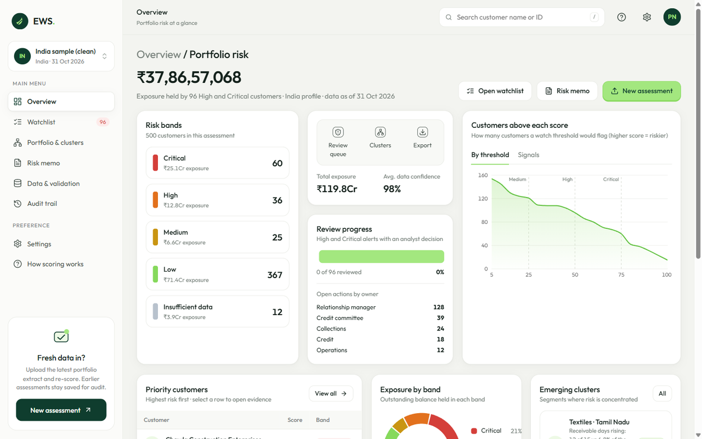
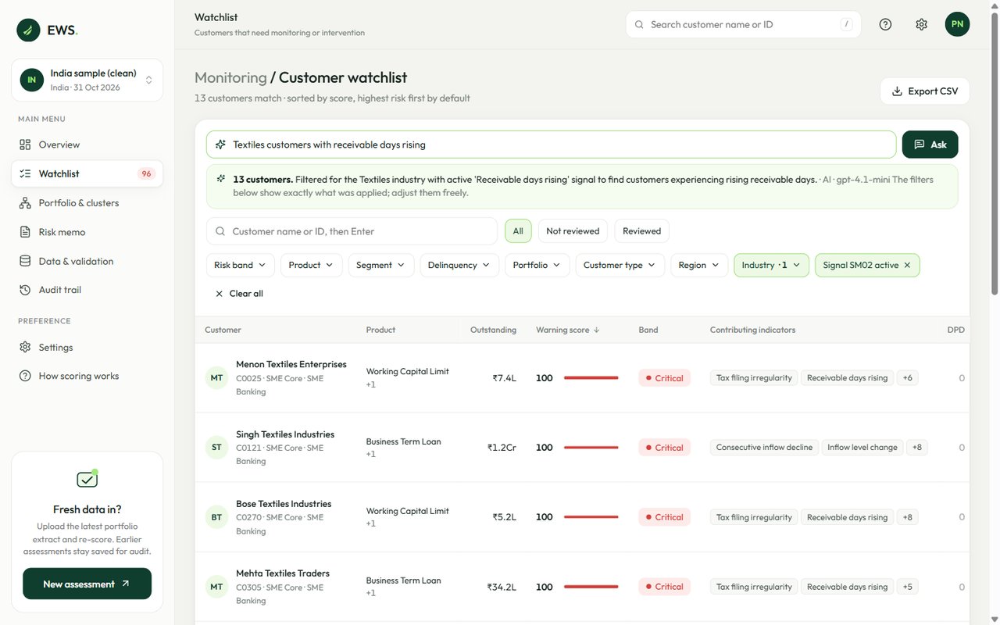
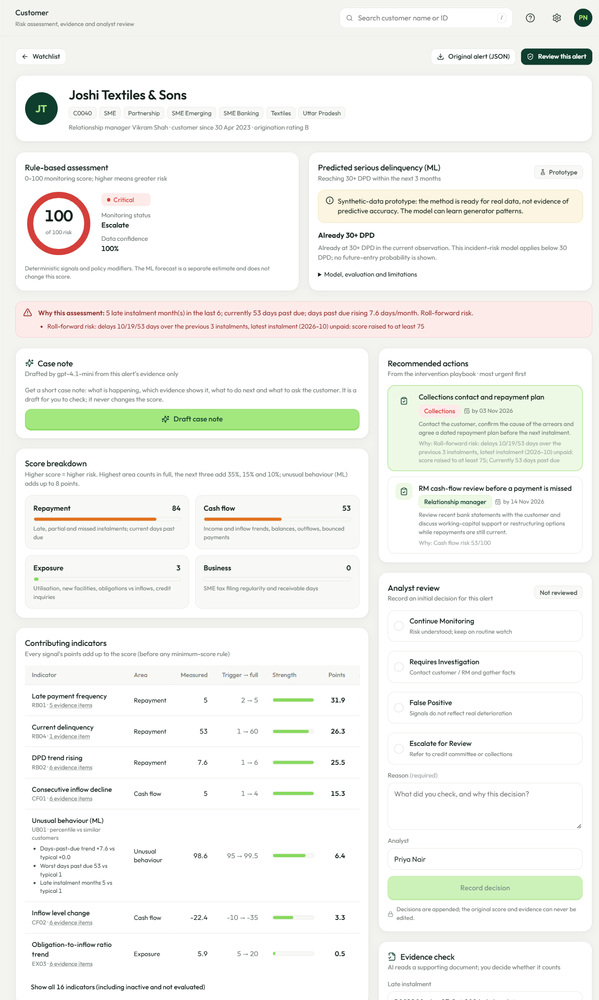
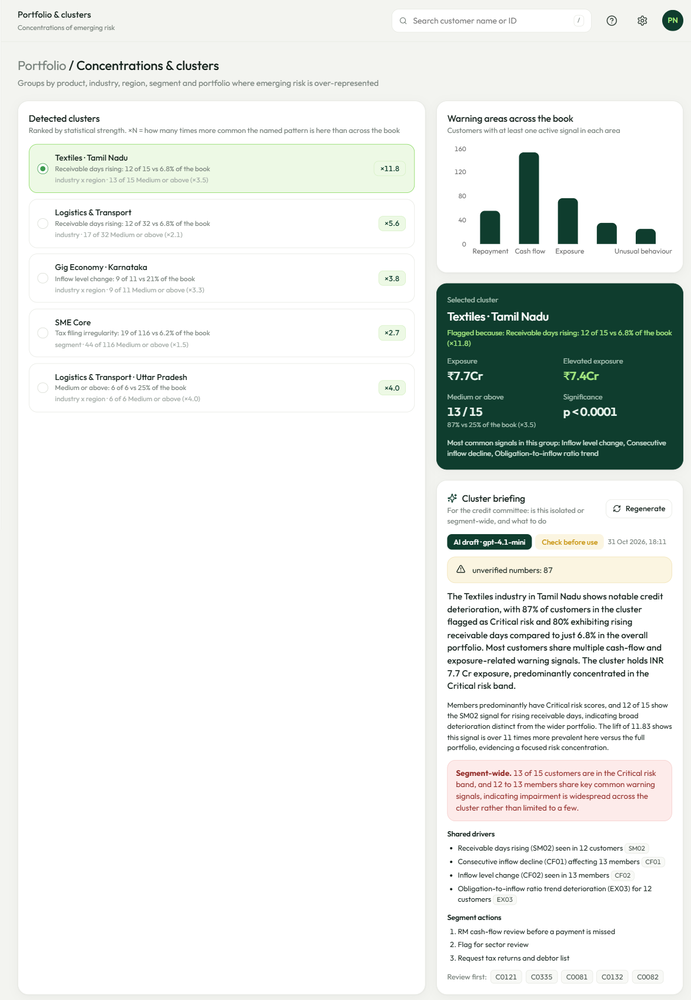
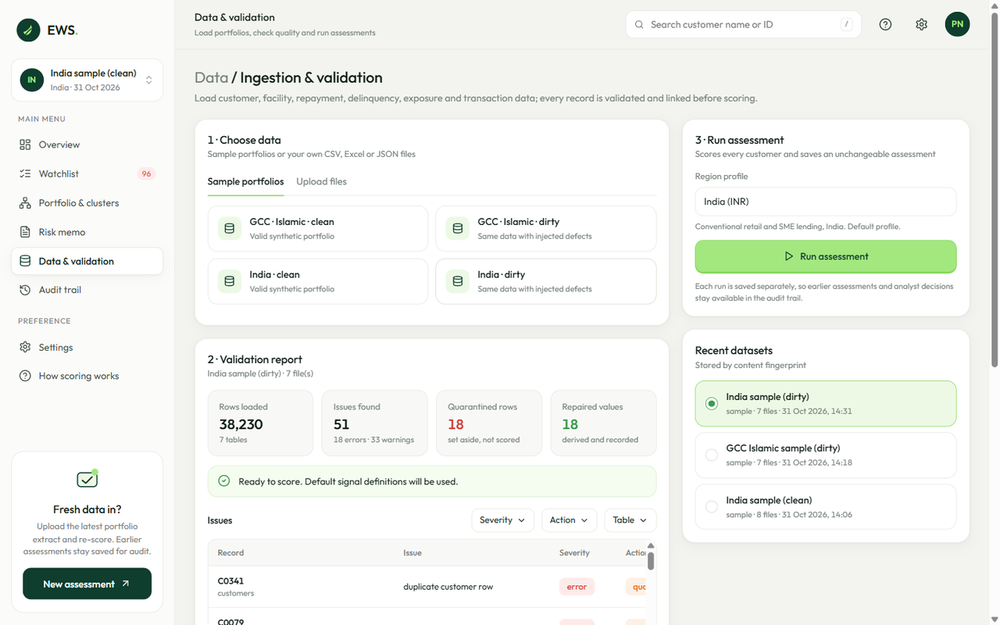
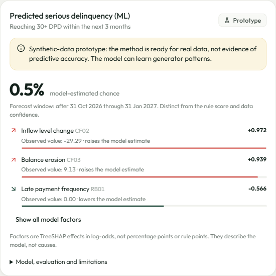
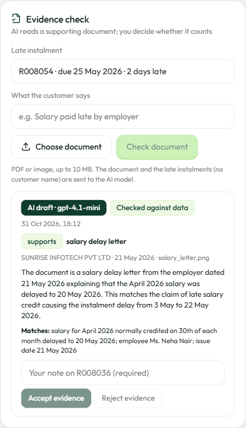
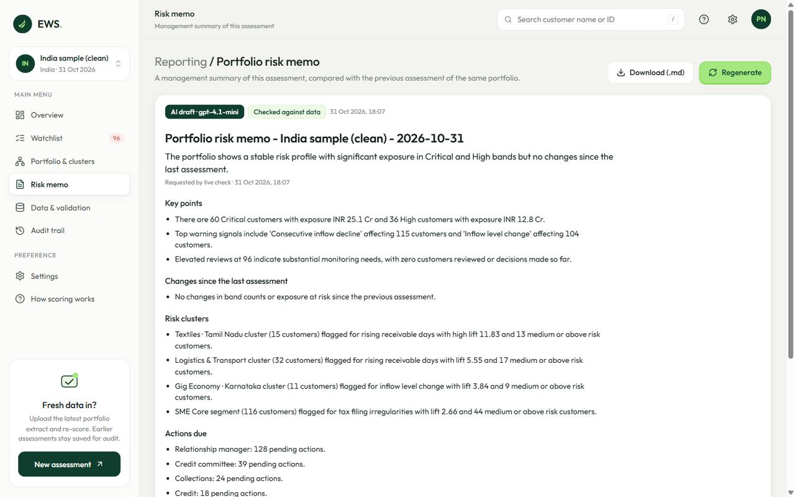

# BreadAhead

**An explainable early warning system for credit risk.** BreadAhead watches how each borrower's behaviour changes after a loan is made: repayments, cash flow, borrowing and, for small businesses, business health. It flags deterioration before a default, explains every point of its score, recommends who should act and by when, and keeps an append-only record of every analyst decision.

Built for the Azentio Hackathon 2026 (*AI for Credit Risk Intelligence*).



## What it does

| Capability | How |
|---|---|
| **Ingest and validate** | CSV, Excel or JSON. Every record is checked and linked across customers, facilities, repayments, delinquency, exposure, transactions and SME indicators. Unusable rows are quarantined, derivable values repaired, everything reported. AI or fuzzy column mapping for a bank's own file layout. |
| **Detect early warning signals** | 15 configurable rule signals across repayment, cash flow, exposure and SME health, plus an isolation-forest model that flags behaviour no rule anticipated. |
| **Score and explain** | A 0–100 Early Warning Score (higher = riskier) whose signal points add up to the score. Adjustments for one-off misses, seasonality, holidays and roll-forward risk are spelled out. Thin history gives "Insufficient data", never a guessed band. |
| **Predict** | An XGBoost estimate of reaching 30+ DPD within three months, with TreeSHAP factors, shown beside (never changing) the rule score. |
| **Prioritise** | Filterable watchlist with each customer's next action, statistically tested portfolio clusters, and a rules playbook of recommended actions with owner and due date. |
| **Assist with AI** | Case notes, plain-English watchlist search, cluster briefings, a management risk memo, column mapping and document evidence checks. Every output is checked in code against the evidence, and all features work without an API key. |
| **Record decisions** | Continue Monitoring, Requires Investigation, False Positive or Escalate for Review, each with a reason. Original scores and evidence can never be edited; database triggers reject updates and deletes. |

Two region profiles are included: **India** (INR) and **GCC Islamic** (AED, Islamic contract types, Shariah-compliant rescheduling).

## Screenshots

| Watchlist with Ask EWS | Customer evidence |
|---|---|
|  |  |
| **Portfolio clusters and AI briefing** | **Data validation** |
|  |  |
| **ML forecast** | **AI evidence check** |
|  |  |



## Documentation

| Document | Contents |
|---|---|
| [Project documentation (PDF)](docs/BreadAhead_Project_Documentation.pdf) | Full feature reference, walkthrough, validation results, governance, API and repository layout |
| [ENGINE.md](ENGINE.md) | Signals, scoring, adjustments, confidence, clusters and validation rules |
| [ML_MODEL.md](ML_MODEL.md) | Forecast target, point-in-time features, splits, calibration and limitations |
| [AI_INTEGRATION_PLAN.md](AI_INTEGRATION_PLAN.md) | Design of the AI assistants and their safeguards |
| [docs/DEMO_GUIDE.md](docs/DEMO_GUIDE.md) | Demo script, parameter reference and how ML and AI are used |

## Quick start

Requires Python 3.11+ and Node 20+.

```bash
python -m venv .venv
.venv/Scripts/activate            # macOS/Linux: source .venv/bin/activate
pip install -r requirements.txt

cd web && npm ci && npm run build && cd ..
python -m api                     # http://127.0.0.1:8000  (API docs at /docs)
```

Then open the app and go to **Data & validation**:

1. Pick a sample portfolio (India or GCC Islamic, clean or dirty) or upload your own CSV, Excel or JSON files.
2. Review the validation report.
3. Click **Run assessment**.

### Development

```powershell
npm install                            # installs the web dependencies too
./.venv/Scripts/python -m pip install -r requirements.txt
./.venv/Scripts/python -m api --reload  # terminal 1: http://127.0.0.1:8000
npm run dev                            # terminal 2: http://localhost:5173
```

The Vite server proxies `/api` requests to the Python API, so both processes must run. Root-level `npm run build` and `npm run typecheck` forward to the web app. On macOS/Linux, use `.venv/bin/python` in place of `.venv/Scripts/python`.

### Configuration

Copy [.env.example](.env.example) to `.env` (git ignores it). Variables already set in the environment take priority.

| Setting | Default | Purpose |
|---|---|---|
| `OPENAI_API_KEY` | not set | Enables the AI assistants. Without it they fall back to rules |
| `EWS_AI_MODEL` | `gpt-4.1-mini` | OpenAI model for all AI features |
| `EWS_AI_ENABLED` | `1` | Set to `0` to turn AI off |
| `EWS_AI_SEND_NAMES` | not set | Set to `1` to include customer names in what is sent to OpenAI |
| `EWS_VAR_DIR` | `var/` | Stored datasets, evidence documents and the evidence database |
| `EWS_DB_PATH` | `var/ews.sqlite3` | Evidence database file |
| `EWS_DATA_ROOT` | `data/` | Sample portfolios |
| `EWS_ML_MODEL_DIR` | `models/delinquency_3m` | Forecast model directory |

## How scoring works

- Each signal's strength rises from 0 at its trigger to 1 at full strength; points = weight × strength.
- Four areas (Repayment, Cash flow, Exposure, Business) are scored 0–100 and combined as highest + 0.35 × second + 0.15 × third + 0.10 × fourth. The unusual-behaviour signal adds up to 8 more.
- Adjustments: one-off misses are dampened (×0.25 with evidence, ×0.6 without), seasonal dips that match last year ×0.3, weekend and holiday delays are exceptions, roll-forward risk sets a floor of 75 and a recent delinquency episode a floor of 25.
- Bands: **Low** 0–24, **Medium** 25–49, **High** 50–74, **Critical** 75–100.
- Missing data never adds points. Fewer than 4 repayment months or under 50% confidence gives **Insufficient data**.

Thresholds, weights and region rules live in [config/](config/), not code. Full detail in [ENGINE.md](ENGINE.md).

## Recommended actions and AI assistants

Every alert gets **recommended actions** from a rules playbook ([config/interventions.json](config/interventions.json)): who acts (collections, RM, credit, operations), by when, and the signals that triggered it.

| Feature | Where | What it does | Without a key |
|---|---|---|---|
| **Case note** | Customer | Summary, cited findings, ranked next steps, questions for the customer, data gaps and a suggested decision; **Use in review** prefills the review form | Rules draft |
| **Ask EWS** | Watchlist | Turns a question ("critical SMEs in Tamil Nadu not yet reviewed") into filters chosen only from real values | Keyword matching |
| **Cluster briefing** | Portfolio & clusters | Pattern, shared drivers, segment-wide or isolated, segment actions, customers to review first | Built from the cluster's figures |
| **Risk memo** | Risk memo | Management summary with changes since the previous assessment; Markdown download | Built from the summary figures |
| **Column mapping** | Data & validation | Maps a bank's own files and columns to ours; reviewed before upload | Fuzzy name matching |
| **Evidence check** | Customer | Reads a PDF or image explaining a late payment; the analyst accepts or rejects it | Stored for manual review |

Safeguards shared by all of them:
- **Limited input.** Customer names are never sent unless `EWS_AI_SEND_NAMES=1`.
- **Fixed output.** Each feature returns a fixed schema through structured outputs.
- **Checks in code.** Citations, actions and numbers must exist in the evidence, and wording such as "default rate" is flagged.
- **Add-only storage.** Outputs are stored add-only and reused when the input hasn't changed.
- **Fallback.** A rules-based version is shown when the AI call fails or no key is set.

Nothing AI-generated changes a score or records a decision.

## Three-month delinquency forecast (ML)

The customer page pairs the rule score with a gradient-boosting estimate of reaching **30+ DPD within the next three months**, with local TreeSHAP factors. Retrain with `python -m ews.ml.train`.

**Synthetic-data prototype: the method is ready for real data, but this is not evidence of predictive accuracy.** The generated history has very few serious outcomes. Customers already at 30+ DPD or with insufficient history get an explicit status instead of an invented probability. See [ML_MODEL.md](ML_MODEL.md).

## Tests

```bash
python -m pytest                  # 98 tests: engine, validation, scenarios, API, AI (fake providers), ML
cd web && npm run typecheck
```

The synthetic generator ([scripts/generate_data.py](scripts/generate_data.py)) plants a known scenario for every customer. On the clean samples, no safe customer is rated High or Critical, and all planted clusters are found. `ground_truth.csv` is used only by tests, never by the app.

## Tech stack

Python 3.12 · FastAPI · pandas · scikit-learn · XGBoost · SQLite · OpenAI · React 18 · TypeScript · Vite · TanStack Query · Recharts

## Repository layout

```
api/            FastAPI app, dataset registry, presenters, AI assistants
ews/engine/     validation, signals, scoring, clusters, unusual-behaviour model
ews/ml/         delinquency forecast: features, training, prediction service
ews/store/      append-only SQLite evidence store
web/            React + TypeScript front end (Vite)
config/         signal definitions, intervention playbook, region profiles
models/         versioned forecast model
data/           generated sample portfolios (ground_truth.csv is for tests only)
scripts/        synthetic data generator
docs/           project documentation, demo guide, screenshots
tests/          automated tests
```

## Limitations

- All results come from synthetic portfolios. Thresholds and both ML models need calibration on real bank history.
- There is no authentication yet. Analysts enter their name in Settings; production needs SSO and role-based access.
- Core banking, credit bureau and account-aggregator integrations, and scheduled re-scoring, are not built.
- The front end is designed for laptop and desktop widths.

## Team

Ashwin Menon and Tanmay Bhandari.
